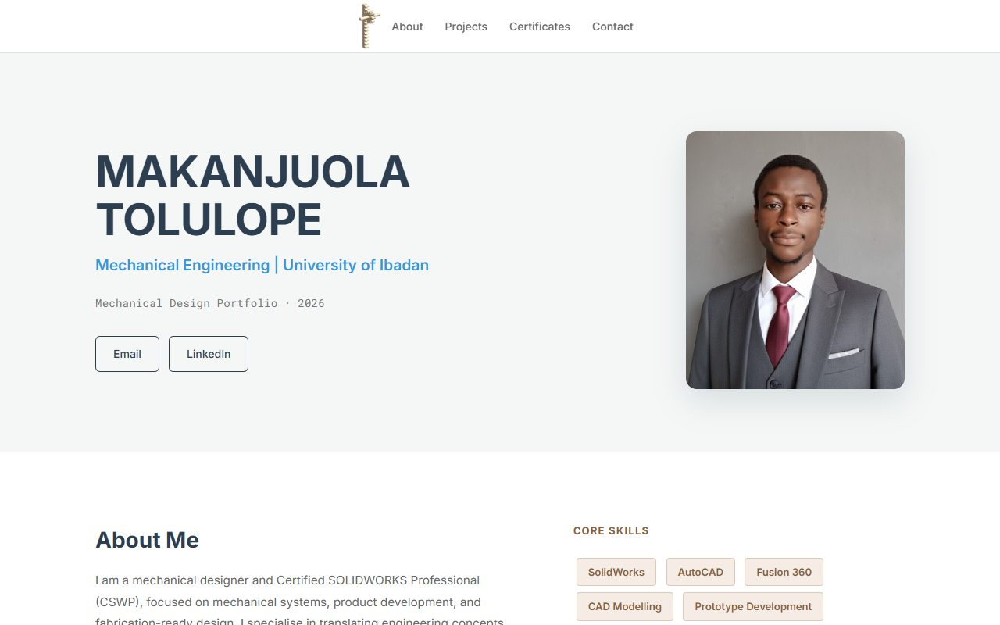

# Mechanical Design Portfolio: Makanjuola Tolulope

**Live site: [tolulope-makanjuola.github.io/mechanical-design-portfolio](https://tolulope-makanjuola.github.io/mechanical-design-portfolio/)**

Mechanical designer and Certified SOLIDWORKS Professional (CSWP). This portfolio shows fabrication-ready CAD, FEA and
machine design work across robotics, process equipment and agricultural machinery, from concept and analysis to
technical drawings and built machines.

## Projects

| # | Project | Highlights |
|---|---|---|
| 01 | [AI-Integrated Pick-and-Place Robotic Arm](https://tolulope-makanjuola.github.io/mechanical-design-portfolio/project-arm.html) | Five-joint arm, camera detection, inverse kinematics, FEA, interactive 3D model |
| 02 | [Incinerator for Medical Waste](https://tolulope-makanjuola.github.io/mechanical-design-portfolio/project-imw.html) | Design, technical drawings, fabricated unit |
| 03 | [Briquette Press](https://tolulope-makanjuola.github.io/mechanical-design-portfolio/project-bp.html) | Design, exploded drawing with BOM, fabricated unit |
| 04 | [15 Litres Bio-Ethanol Reactor](https://tolulope-makanjuola.github.io/mechanical-design-portfolio/project-ber.html) | Process equipment design, fabricated unit |
| 05 | [Automated Cassava Weeder Robot](https://tolulope-makanjuola.github.io/mechanical-design-portfolio/project-acwr.html) | Robot chassis and assembly design |
| 06 | [Photo-Electrocoagulation Water Treatment Unit](https://tolulope-makanjuola.github.io/mechanical-design-portfolio/project-pewtu.html) | Assembly design and drawings |
| 07 | [Open Channel Flow Teaching Apparatus](https://tolulope-makanjuola.github.io/mechanical-design-portfolio/project-ocfta.html) | Sheet metal design, FEA of the supply tank |
| 08 | [Battery-Powered Grass and Weed Cutter](https://tolulope-makanjuola.github.io/mechanical-design-portfolio/project-gwc.html) | Machine design, fabricated unit |

## Certifications

- Certified SOLIDWORKS Professional (CSWP), Design
- SOLIDWORKS Simulation Associate (CSWA-Simulation)
- Certified SOLIDWORKS Associate (CSWA)
- Dassault Systèmes AAKRUTI Innovation Competition 2025, participant

## Skills

SOLIDWORKS (CAD, Simulation, Motion), AutoCAD, Fusion 360, FEA, technical drawing, design for manufacturing,
prototype development, robotics and kinematics, Python.

## Portfolio PDF

[Download the PDF portfolio](files/Mechanical%20Design%20Portfolio%20-%20Tolulope%20Makanjuola.pdf)

## Contact

- Email: [makanjuolatolulope8@gmail.com](mailto:makanjuolatolulope8@gmail.com)
- LinkedIn: [linkedin.com/in/makanjuola-tolulope](https://linkedin.com/in/makanjuola-tolulope)

## About this repository

A static website (HTML and CSS, no build step) published with GitHub Pages from the `master` branch.

| Path | Contents |
|---|---|
| `index.html` | Home page: about, certificates and project cards |
| `project-*.html` | One detail page per project |
| `style.css` | All styles |
| `images/`, `models/`, `js/` | Images, the 3D model of the robotic arm and its viewer |
| `files/` | The downloadable PDF portfolio |

© Makanjuola Tolulope. All designs, drawings and images are my own work; please ask before reusing them.
